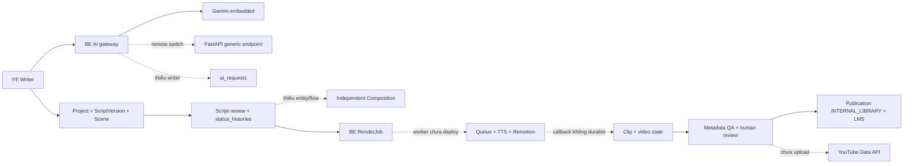

# STEMotion — Audit toàn diện ngày 2026-10-11

**Kết luận:** FE, BE và Supabase đang hoạt động ở mức truy cập, xác thực và schema; chưa có bằng chứng production hoàn thành một video. Worker chưa deploy. Những khoảng trống quan trọng còn lại là Composition độc lập, ghi log mọi AI call, reliability của render/callback, QA trên artifact thật, và YouTube/OAuth. Demo visual local không thay thế smoke test xuyên FE → BE → worker → DB.

Audit này thực hiện theo lệnh: production chỉ đọc; sửa an toàn ở local và commit riêng; không push, deploy, migration, thay env/secret hoặc làm phase tiếp theo. **Sau báo cáo dừng đợi lệnh.**

## 1. Chuẩn đối chiếu và mức bằng chứng

Nguồn chuẩn:

- `FA26SE054_STEMOTION_AI_ASSISTED_STEM_VIDEO_PRODUCT_hungld.pdf`: đã đọc toàn bộ 5 trang, dùng yêu cầu chức năng và phi chức năng trong hồ sơ.
- `Diagram/Phase0/STEMotion_Design_Phase0_DRAFT.drawio`: baseline duy nhất ngày 2026-10-10, ba trang domain/use case/DB; XML parse hợp lệ, 65/93/191 cells. Đã xem bản ERD export. Quyết định anh duyệt trong `docs/PHASE0_APPROVAL_AND_AI_PLACEMENT.md` thay thế các nhãn pending trên bản draft.
- Bốn quyết định Phase 0, cộng các quyết định sau đó: không public register; Clip trong Phase 1; archive project; chặn xóa scene có feedback; AI service trong `STEMotion_BE/services/ai`; Gemini provider ban đầu; Whisper placeholder được phép defer.
- `proposal-vs-implementation.md`, báo cáo Bond/Muse và `STEMotion_Agent_Context.md` chỉ là lịch sử, **không dùng kết luận cũ làm bằng chứng code hiện tại**.

Ký hiệu bảng: **✅** đã có bằng chứng trong tầng được nêu; **⚠️** một phần/không đầy đủ; **❌** thiếu; **?** chưa xác minh. “Git có” là source trên SHA đã fetch, không phải khẳng định runtime chạy SHA đó. “DB có bảng” không đồng nghĩa use case đã chạy.

Giới hạn chủ động: không có dashboard Vercel/Render đã đăng nhập hoặc phiên người dùng production trong công cụ hiện tại. Không lấy token người dùng, không POST login/register/AI/render/publish, không tạo fixtures trên Supabase—even nếu định rollback. Vì vậy role test đầy đủ là test local; xác minh production chỉ dùng GET/OPTIONS và SELECT trong transaction READ ONLY.

## 2. Snapshot local → GitHub → production

Org: `STEMotion-Capstone-FALL-2026`. Đã fetch tất cả remote branch của ba repo trong lượt audit, không push.

| Repo | Local tại đầu audit | GitHub đúng branch, đã verify | Local sau các fix audit, trước commit báo cáo | Production |
|---|---|---|---|---|
| BE | `deploy/render-staging`, `124344e`, ahead 4/behind 0 | `deploy/render-staging`: `114dc69c88c92e8371d10c372eb6bdebd3e3326e` | `f725c4c`, ahead 6/behind 0 | `https://stemotion-be.onrender.com/`: health/readiness UP; **SHA runtime chưa verify** |
| FE | `main`, `bbd8456`, ahead 7/behind 0 | `main`: `0d7502e48d9ea96634f0b34ae64eceaa43a5aa0f` | `e0485c5`, ahead 10/behind 0 | `https://stemotion.vercel.app/`: HTTP 200; bundle gọi BE production; **SHA alias runtime chưa verify trực tiếp** |
| RENDER | `main`, `ddba8cf`, ahead 3/behind 0 | `main`: `ebf91f0209f6f36d4529a4c069e55827b161e718` | Không sửa code worker trong audit | **Chưa deploy**, theo trạng thái anh đã xác nhận; chưa có VPS/URL worker để kiểm chứng |
| Supabase | Source migration tới V14 | BE deployment branch có tới V13 | Không apply migration | SELECT xác nhận V1–V13 success, **V14 chưa áp dụng** |
| FastAPI AI | BE/services/ai, generic endpoint | Source generic endpoint đã có trên BE branch | Không sửa provider/service trong audit | **?** Chưa xác nhận service riêng được deploy hoặc BE đang dùng remote mode |

**BE `origin/main` là `bdacd8a`, khác deployment branch.** Không lấy main để kết luận bản BE đang triển khai hoặc trộn hai branch trong báo cáo.

### GitHub Actions và Vercel

Đã GET GitHub Actions API theo branch, không suy từ combined-status rỗng:

| Repo / SHA GitHub | Kết quả CI gần nhất | Bằng chứng |
|---|---|---|
| BE `114dc69` | completed / success / push | [CI BE](https://github.com/STEMotion-Capstone-FALL-2026/STEMotion_BE/actions/runs/38034504159) |
| FE `0d7502e` | completed / success / push | [CI FE](https://github.com/STEMotion-Capstone-FALL-2026/STEMotion_FE/actions/runs/38032062134) |
| RENDER `ebf91f0` | completed / success / push | [CI worker](https://github.com/STEMotion-Capstone-FALL-2026/STEMotion_RENDER/actions/runs/38035244195) |

Worker CI trước đó `2c4b3e3` fail; `ebf91f0` chứa fix gọi binary `remotion` rõ ràng và CI đã xanh. Workflow này cài Chromium và smoke boot HTTP server; **không deploy VPS, không render MP4 end-to-end**.

Commit FE `0d7502e` có Vercel status success, target [deployment](https://vercel.com/letran30s-projects/stemotion/DbuVc84ZoZs9Pib7y9MRRVybTq8s). Đây là bằng chứng deployment của commit, chưa đủ để xác nhận mọi alias hiện tại trỏ chính xác commit đó.

### Production đọc được

| Kiểm tra | Kết quả đã verify | Giới hạn |
|---|---|---|
| GET FE | 200, asset `index-BHOfjeM4.js` | Không chứng minh mọi trang/role hoạt động |
| Bundle FE | Có BE URL production; không thấy localhost:8080 hoặc `/auth/register`; có `/users`, AI generate và render API paths | Đối chiếu bundle tĩnh, không thực hiện thao tác đăng nhập |
| Bundle publication/visual | Không có `INTERNAL_LIBRARY`, nhãn publish library mới, `PhaseBMotionReview` | Phù hợp với FE commits chưa push; không dùng marker đơn lẻ làm bằng chứng SHA chính xác |
| BE health/readiness sau khi warm | 200, lần lượt 3.22s / 0.77s, status UP | Ban đầu ba GET timeout 60s; cold start/network là **suy đoán**, chưa có logs để chốt nguyên nhân |
| BE OpenAPI | 200, lưu được spec, ~25s | Spec runtime không chứng minh implementation service bên trong |
| Guest GET `/api/v1/users` | 401 | Không thay thế local test ADMIN/non-ADMIN POST |
| Guest GET `/api/v1/auth/register` | 401 | Không dùng GET này để kết luận riêng POST register production; POST đã kiểm thử local |
| OPTIONS login, origin FE | 200, Allow-Origin chính xác `https://stemotion.vercel.app`, methods phù hợp | Không kiểm tra mọi preview domain Vercel |
| OPTIONS login, origin không được tin cậy | 403, Invalid CORS request | CORS không thay thế resource authorization |
| Supabase | `transaction_read_only=on`; SELECT schema/constraints/triggers/count; rollback transaction chỉ đọc | Không chạy migration, DML, fixtures hay test up/down trên production |

DB public có **20 bảng**, gồm cả `compositions`, `asset_media`, `scene_assets`, `review_decisions`, `templates` của ERD gốc. Vì vậy kết luận cũ “chưa có các bảng này trong DB” không còn được dùng; **đúng hơn là code/flow chưa sử dụng chúng**.

Count tại snapshot khoảng 14:46–14:47 GMT+7: users 2; workspaces 2; workspace_members 2; clip_projects 3; script_versions 3. Scenes/compositions/render_jobs/clips/ai_requests/publications/publish_records/status_histories/feedback_comments/asset_media/scene_assets/templates/remotion_templates đều **0**. Không SELECT dữ liệu nhận dạng tài khoản hoặc nội dung riêng tư. Không query count review_decisions nên không tự suy là 0.

**Không có artifact/job/publication trong snapshot để chứng minh pipeline production đã hoàn thành.** Count 0 không chứng minh API không tồn tại hoặc chưa từng chạy trước snapshot.

## 3. Ma trận yêu cầu đề cương × local / Git / prod

| Hạng mục đề cương | Local hiện tại | GitHub đúng branch | Production đã verify / chưa verify |
|---|---|---|---|
| Studio 5 bước, human review | ⚠️ UI 5 bước, dual-state, submit/review có; Producer Composition thiếu | ⚠️ Workflow APIs có; thiếu Composition như local | FE hiển thị; không có dữ liệu video để verify bước 3–5 |
| Writer project, subject/grade, scene editor | ✅ CRUD/scene save; IDs ổn định; lỗi dữ liệu AI trọng yếu đã guard local | ✅ API/save; ❌ guard dữ liệu AI mới và role PUT mới chưa push | 3 projects/versions, 0 scenes; đăng ký thành công trước đây là bối cảnh anh xác nhận, không phải test mới |
| Version history, inline feedback, resubmit | ⚠️ Script version/review thật; feedback permission và clip binding thiếu | ⚠️ Cùng mức triển khai | Bảng tồn tại; chưa verify authenticated flow |
| AI segmentation/readability/concepts/terms | ⚠️ Gemini embedded + remote gateway/generic FastAPI | ⚠️ Có source trên branch | Mode/model/key và AI response runtime **?**; không gọi API tốn quota |
| Accept/ignore, cost & usage | ❌ Chưa có service/API persistence quyết định hoặc log từng call | ❌ Repository/entity/schema có, flow chưa có | ai_requests 0; không có usage để đối soát |
| FastAPI + LangChain AI layer | ⚠️ Generic generation, auth, timeout, provider retries | ⚠️ Source/CI có | Service riêng deployment **?**; chưa đủ specialized hooks và tracking |
| GPT theo đề cương | Gemini được anh duyệt làm provider ban đầu | Cùng quyết định | Không coi đổi provider được duyệt là lỗi kiến trúc |
| Producer independent Composition, edit assets/properties | ❌ Không entity/service Composition; đang dùng script scenes | ❌ Tương tự | compositions 0; approved script khóa sửa nên UI edit không hoàn thành flow |
| Preview Remotion + template types | ✅ Browser Player/12 legacy scene types; Phase A/B local | ✅ Legacy registry; ❌ Phase A/B chưa push | Legacy FE có; cinematic demo không được đưa lên prod |
| Submit render, progress, retry tối đa 3 | ⚠️ FE gọi BE thật, worker Node/BullMQ có; reliability thiếu | ⚠️ API/poll/callback có | Worker chưa deploy → **blocker render production** |
| MP4 H.264 1080p 30fps | ✅ Demo local có MP4; code worker cấu hình codec/resolution | ⚠️ Code có, CI chỉ boot server | Không có MP4 production được verify |
| TTS narration | ⚠️ Local strict FPT + Edge demo đo audio; Google Cloud provider và fallback Google Translate unofficial | ⚠️ Chưa có các cải tiến FPT/Edge mới | Worker chưa deploy; FPT free bị quota trước đây, không test lại quota trong audit |
| Whisper captions + regeneration | ❌ Chưa thật; placeholder được phép defer | ❌ Chưa triển khai use case captions đầy đủ | Không có captions runtime được verify |
| QA duration/overflow/contrast/audio-caption | ⚠️ Heuristic trên scenes; chưa đo artifact/audio/caption thật | ⚠️ Tương tự | Không artifact để verify; không coi heuristic là QA đầy đủ |
| Reviewer clip annotations/approve/reject | ⚠️ Clip sign-off pin artifact; timestamp comment vẫn project-bound | ⚠️ Tương tự | clips/status_histories 0 |
| YouTube Data API upload/channel OAuth | ❌ Không upload; API trả unavailable rõ ràng | ❌ Tương tự | Không tuyên bố mock URL là publish thành công |
| Internal library + LMS embed/export | ✅ BE canonical publication + legacy adapter; FE flow mới local | BE ✅; FE ❌ commit publication chưa push | publications/publish_records 0; không verify publish runtime |
| Browse library theo subject/grade | ⚠️ Catalog/project/filter/export code; không asset_media catalog | ⚠️ FE library mới chưa đầy đủ trên remote | Không publication để verify dữ liệu |
| Admin users/roles/templates | ⚠️ ADMIN provisioning/update APIs, invite thật; global user/role UI chưa hoàn thiện; metadata != executable component | ⚠️ API/UI nền có | Guest users 401; ADMIN operations chưa gọi production |
| Admin queue/success/storage/AI cost | ⚠️ Jobs metrics có; CPU/disk là BE host; successRate mặc định 100 khi chưa có job; AI metrics thiếu | ⚠️ Tương tự | Không verify authenticated metrics; worker telemetry chưa có |
| JWT + Google OAuth, admin cấp account | JWT/admin-only ✅; Google OAuth ❌ | ✅ Đóng register/admin provision; OAuth ❌ | Bundle không signup, guest 401; POST role test ở local |
| PostgreSQL + MinIO/S3 + Redis pool | ⚠️ Supabase thật; worker storage/queue code có, durability/fallback/URL expiry cần xử lý | ⚠️ Có source | DB UP; Redis/MinIO/worker runtime chưa có bằng chứng |
| Docker + CI/CD | ⚠️ Dockerfiles/CI có; BE/FE hosting hoạt động; worker deploy chưa có | ✅ CI xanh cả 3 branch; deployment không đồng nghĩa CI | BE/FE live; VPS chưa có, AI runtime ? |
| <15s AI, <5min render, <3s dashboard | ❌ Chưa benchmark hợp lệ cho mục tiêu | Không có acceptance benchmark | BE latency quan sát có >3s, nhưng không phải benchmark dashboard; chưa kết luận pass/fail SLA tổng |
| 300 render jobs/ngày, 200 users | ❌ Chưa load/capacity test | Chưa acceptance evidence | Không có worker để đo capacity |
| Encryption at rest cho credentials/assets | ⚠️ Password BCrypt, secret env; không đủ evidence storage/key encryption vận hành | Chưa có đầy đủ deployment policy | Supabase/storage provider setting không được mở dashboard để verify |
| Chrome/Firefox/Edge/Safari compatibility | ⚠️ Chromium render/local tests; chưa full browser matrix | CI không full browser matrix | Chưa verify Firefox/Safari |
| 10+ beta STEM clips và tài liệu bàn giao | ⚠️ Demo local + docs nhiều phần; API spec/deployment guide còn stale | Docs baseline có, visual docs chưa push | Không có bộ 10 clip production được chứng minh |

## 4. Ma trận domain / ERD

| Entity / bảng | Local ORM/flow | GitHub | Supabase production / lệch shape |
|---|---|---|---|
| Writer/Reviewer/Producer/Admin → users | ✅ Actors tách trên domain; User + bốn role trong ORM | ✅ | users có; google_id không có OAuth flow |
| ClipProject → clip_projects | ✅ Workspace + dual script/video + derive pipeline; archive | ✅ | Bảng có cả shape gốc và mở rộng; không tự tạo thêm pipeline authoritative song song |
| ScriptVersion → script_versions | ✅ Version, review binding, lock approved | ✅ | 3 rows; không có Composition lifecycle độc lập |
| Composition → compositions | ❌ Không Java entity/service/draft workflow | ❌ | **Bảng đã tồn tại, 0 rows**; không đồng nghĩa feature đã làm |
| Scene → scenes | ✅ Stable IDs, chặn xóa có feedback | ✅ | Code dùng version_id; DB còn composition_id theo ERD. Thiếu chuyển tiếp Composition |
| Template → templates/remotion_templates | ⚠️ ORM/API dùng remotion_templates; FE executable registry riêng | ⚠️ Metadata API/legacy registry; V14 chỉ local | Hai bảng đều tồn tại, 0 rows; FK scenes.template_id còn trỏ templates. Phải mapping rõ catalog nào authoritative |
| RenderJob → render_jobs | ⚠️ Project/version/job tracking, chưa Composition FK trong ORM/payload | ⚠️ | Bảng có composition_id gốc + project/version mở rộng; 0 rows |
| Clip → clips | ✅ V10 entity, unique render job, current artifact binding | ✅ | Có bảng/FK/unique; 0 rows. duration_sec chưa điền, qa_status/report chưa có flow cập nhật đầy đủ |
| Asset_Media → asset_media | ❌ Chưa DB catalog/CRUD/ownership tích hợp | ❌ | Có bảng, 0 rows. Parametric React assets Phase B không thay thế DB uploaded-media entity |
| SceneAssets → scene_assets | ❌ Chưa associations/slot persistence | ❌ | Có join table, 0 rows |
| AI_Request → ai_requests | ⚠️ V12, entity/repository/schema; **không có nơi gọi repository ghi request** | ⚠️ | Có columns token/cost/failure/decision, 0 rows |
| FeedbackComment → feedback_comments | ⚠️ Inline scene và timestamp project; không map clip target | ⚠️ | Cả clip_id/version/native columns và extensions tồn tại; code chưa dùng clip_id |
| ReviewDecision → status_histories | ✅ Explicit event/target/decision/reason, append-only, review kể cả state không đổi | ✅ | Columns/check/index/triggers đã verify; 0 rows |
| review_decisions cũ | Không nguồn ghi mới theo quyết định đã duyệt | Cùng trạng thái | Bảng gốc vẫn tồn tại; không drop trong audit, không coi tồn tại vật lý là nguồn ghi thứ hai |
| Publication → publications | ✅ Canonical INTERNAL_LIBRARY, project unique, Clip reference | ✅ BE; FE flow chưa push | Cả UNIQUE(project_id,platform) và original UNIQUE(clip_id,platform) tồn tại; project unique vẫn giới hạn một version/platform |
| publish_records | ✅ Adapter/legacy API giữ tương thích; không drop | ✅ | Bảng có, 0 rows |
| Workspace → workspaces | ✅ Entity/API/resource scope | ✅ | Có 2 rows |
| WorkspaceMember → workspace_members | ✅ Membership/invite hash/expiry, account phải được cấp sẵn | ✅ | Có 2 rows; không dùng invite để mở public register |
| StatusHistory pipeline events | ✅ Derived-state transition history, archive giữ lịch sử | ✅ | Append-only UPDATE/DELETE trigger đã đọc; TRUNCATE protection có trong source và migration tests |
| flyway_schema_history | V1–V14 trong local source | V1–V13 trên deployment branch | V1–V13 success; không V14 |

**V14 deployment trap:** local `RemotionTemplate` đã map `subject`, `asset_pack`, `slots`, nhưng production schema chưa có các columns này. `application-cloud.yml` đặt **Flyway disabled, Hibernate validate**. Vì vậy **push BE không tự chạy V14**; nếu deploy entity mới mà chưa thực hiện migration được duyệt thì có nguy cơ startup validate fail. Không được dùng lời nhắc cũ “push là Flyway V14 tự chạy” làm kế hoạch rollout. Audit không thay đổi setting này hoặc áp dụng V14.

## 5. Ma trận toàn bộ use case trong diagram

Trong cột production, “?” nghĩa chưa thực hiện flow authenticated; “worker chưa có” là chặn vận hành đã biết. Không đánh dấu use case hoàn tất chỉ vì endpoint có trong OpenAPI.

| Use case | Local sau audit | GitHub đúng branch | Production |
|---|---|---|---|
| Login via OAuth / JWT | ⚠️ JWT thật; OAuth thiếu | ⚠️ | FE live; account đã hoạt động theo anh; OAuth chưa có |
| Create Clip Project | ✅ API thật; AI thiếu dữ liệu critical bị reject local | ✅ API; guard mới ❌ | 3 project, 0 scene; AI flow ? |
| Edit Clip Project | ✅ Scope + role Writer/Admin + state guards | ⚠️ PUT thiếu role annotation mới | Authenticated update ? |
| Write/Edit Script by Scene | ✅ Stable IDs/save queue; thiếu Composer Producer | ✅ Scene save | Scene data 0; runtime save ? |
| View Script History | ✅ Script versions/API/UI | ✅ | Bảng có; history UI ? |
| Submit Script | ✅ Flush save → submit API | ✅ | ? |
| Request AI Assistance | ⚠️ Real provider/gateway; no request tracking | ⚠️ | Runtime provider/mode ? |
| Accept / Ignore AI Suggestions | ⚠️ UI áp dụng/bỏ, không persisted decision | ⚠️ | ai_requests 0 |
| Read & Resolve Feedback | ⚠️ API/UI; permission/archived mutation gap | ⚠️ | Comments 0 |
| Review Script | ✅ Role + version pin + history | ✅ | ? |
| Add Inline Comments | ⚠️ API/scene binding; writer/delete policy chưa chốt | ⚠️ | ? |
| Approve Script | ✅ Explicit SCRIPT event | ✅ | History 0 |
| Reject Script | ✅ Request changes + new version + explicit event | ✅ | ? |
| Review Rendered Clip | ⚠️ Current Clip binding; chưa artifact production | ⚠️ | Worker chưa có |
| Add Timestamp Annotations | ⚠️ Timestamp API, chưa Clip binding | ⚠️ | Worker chưa có/comments 0 |
| Approve Clip | ✅ Clip/version validation + review event | ✅ | Worker chưa có; chưa exercise |
| Reject Clip | ✅ Clip-bound decision + send-back | ✅ | Worker chưa có; chưa exercise |
| View Automated Pre-publish QA | ⚠️ Metadata heuristics, không media inspection | ⚠️ | Artifact QA chưa verify |
| Compare Versions | ⚠️ Script compare; clip/Composition compare thiếu | ⚠️ | ? |
| Open Draft Composition | ❌ Entity/service/lifecycle thiếu | ❌ | compositions 0 |
| Edit Scene Properties | ⚠️ UI thật nhưng Producer save dùng script API bị lock/role gate | ⚠️ | Chưa có đúng Composition flow |
| Preview Scene | ✅ Remotion Player | ✅ Legacy; Phase A/B ❌ | Legacy preview chưa test session |
| Submit Render Job | ⚠️ Real BE call; cấu hình thiếu bị chặn local | ⚠️ Guard config mới chưa push | Worker chưa có |
| Monitor Render Progress | ⚠️ FE poll BE; callback/durability gaps | ⚠️ | Worker chưa có |
| Swap Suggested Assets | ❌ DB catalog/association chưa có flow | ❌ | asset tables 0 |
| Regenerate/Tune AI Narration & Captions | ⚠️ TTS worker/demo; no caption regeneration | ⚠️ Legacy TTS | Worker chưa có; Whisper defer |
| Publish Clip to YouTube | ❌ Explicit unavailable, không upload/mock success | ❌ | Không deployment uploader |
| Logout | ✅ FE xóa session; no server revocation | ✅ | UI có; revoke chưa có bằng chứng |
| Browse & Export from Media Library | ✅ Local library publication flow; asset catalog thiếu | ⚠️ BE có, FE publication commit chưa push | Publications 0, prod bundle thiếu flow mới |
| View Pipeline Board | ✅ Derive dual-state; enum mapping | ✅ | FE board có; video stages chưa exercise |
| Manage Users & Roles | ⚠️ Provision/update APIs + invite; global management UI chưa đủ | ⚠️ | Guest users 401; ADMIN flow ? |
| Manage Templates | ⚠️ Metadata CRUD, không tự tạo component/registry | ⚠️ | Catalog DB 0; V14 chưa có |
| Monitor Render Queue & Storage | ⚠️ Job rows + BE host metrics; no worker telemetry | ⚠️ | Worker chưa có |
| Monitor AI Cost & Usage | ❌ Không writer log/decision/metrics UI | ❌ | ai_requests 0 |

Các quan hệ extend/include không được xem là đã đáp ứng chỉ vì có nút UI: Accept/Ignore cần AI_Request; Swap cần asset associations; captions cần audio/alignment; Review Clip cần artifact; Preview không thay thế MP4 rendering.

## 6. Bốn quyết định Phase 0: mức tuân thủ

| Quyết định | Source local / Git | DB / prod | Kết luận |
|---|---|---|---|
| Giữ workspace/member/history; dual-status + pipeline derive | ✅ Entity, scope, derive; không rewrite API | ✅ Tables/columns hiện hữu | Đúng hướng; diagram draft vẫn có pending annotations được tài liệu approval supersede |
| ReviewDecision explicit append-only, record khi state không đổi | ✅ `recordReview` không bỏ event; SCRIPT/CLIP binding; scene IDs ổn định | ✅ V11 constraints + triggers; 0 events để kiểm tra nội dung runtime | Schema/source đúng; permissions feedback và clip comments vẫn tách biệt, chưa hoàn thiện |
| Publication hai bước, project unique + legacy adapter, library thật, LMS giữ | ✅ BE transaction hai nguồn canonical/adapter; LMS iframe thật; FE flow chỉ local | ✅ V13/project unique, legacy retained; 0 publication | Đúng Phase 1 ở BE; FE/prod end-to-end chưa hoàn tất. Migration bỏ project unique khi nhiều Clip **chưa thực hiện**, đúng defer riêng |
| Tokens khác tiền, tiền null khi chưa biết | ✅ Schema/entity token input/output + nullable money; không default monetary 0 | ✅ DB columns nullable; ai_requests 0 | Mô hình đúng; **chưa thực thi tracking mọi call**, không đủ để tuyên bố Monitor AI Cost & Usage đã xong |

## 7. Data flow end-to-end và chỗ đứt

| Link | Điều thật trong source | Đứt / giả lập / chưa verify |
|---|---|---|
| Writer → AI → draft | HTTP BE/provider thật; schema/props normalize; project lưu sau AI | Runtime mode/key chưa đọc; trước fix FE có fabricated default scientific content; 4 critical types đã fail-closed local. Không có AiRequest log |
| Script → cinematic Scene Plan | Registry + allowlist BE/FE + adapter duration_sec → frames | **Manual Phase A/B demo**, AI Director integration được defer; legacy AI vẫn trả durationInFrames. Không gọi demo là live AI plan pipeline |
| Draft save → review | Save queue flush, stable IDs, chặn scene có feedback, approved lock, history target version | Chưa chạy writer/reviewer production trong audit; FeedbackComment target clip thiếu |
| Approved script → Producer edit | Browser inspector/Player có | **Composition độc lập thiếu**; editor đang dùng script scenes, approved script không được sửa. Không mở khóa script để lách gap |
| BE job → worker queue | Enqueue HTTP thật, role/state/key guards; local thiếu key/URL/callback bị chặn sớm | Worker chưa deploy; enqueue diễn ra trước transaction commit; chưa outbox/after-commit recovery |
| Worker → MP4 | Real Remotion + headless Chromium, TTS audio embed, H.264 | Generic CI không render artifact; audio-adjusted scenes không trả BE. Demo exact 60s chạy local, không qua full BE pipeline |
| Failure → retry | BE maxAttempts 3, cùng job row; BullMQ attempts 1 | BE re-add **cùng jobId**, worker giữ failed jobs (`removeOnFail: 50`): job còn tồn tại sẽ bị BullMQ bỏ qua. Chưa có attempt identity/snapshot |
| Worker → callback → Clip | Shared key constant-time, fixed destination, terminal duplicate guard, unique Clip per job | Worker callback errors bị log/swallow, không durable retry; BE không poll worker để recover. Chưa DB lock/version cho concurrent callbacks |
| Audio timing → DB → QA | Worker local đo audio và đổi scene frames trong inputProps | Callback chỉ URL/progress, không duration/timing map. DB scene duration và Clip.duration_sec chưa phản ánh audio; QA đọc metadata cũ |
| Clip → QA → publish | Human Clip decision pin artifact; library checks current Clip và metadata QA | QA không inspect MP4/caption/audio; Clip.qa_status/qa_report thiếu cập nhật artifact lifecycle. YouTube unavailable |
| Publication → LMS/video playback | Canonical record + legacy response/iframe HTTPS | MinIO URL có hạn mặc định 7 ngày nhưng persisted như URL vĩnh viễn; không refresh/canonical object-key flow |

BullMQ semantics được xác nhận từ [tài liệu Job IDs chính thức](https://docs.bullmq.io/guide/jobs/job-ids): thêm lại ID còn tồn tại không tạo job mới. **Đã verify source/config và quy tắc của thư viện; chưa chạy reproduction Redis real trong audit này.** Vì vậy tác động retry được phân loại “suy luận được hỗ trợ”, không ghi là incident production đã xảy ra.

Một dead helper `wrap` chứa `model: 'mock'` trong `FE/src/services/scriptService.ts` không được gọi; actual `runAiAction` gọi BE. Không vì search thấy chữ mock mà kết luận AI live là mock. YouTube hiện fail rõ ràng; Submit Render trong App hiện gọi BE thật, không startRenderMock.

## 8. Security và secret handling

| Kiểm tra | Kết quả / phạm vi |
|---|---|
| Supabase credential rotation | Anh đã xác nhận đổi + cập nhật Render. Audit kết nối READ ONLY bằng local credential còn hiệu lực; BE db readiness UP. Không đọc/in password và không rotate thêm secret |
| Compose passwords | BE local commit `85626f3` dùng `${DB_PASSWORD}` và `${MINIO_ROOT_PASSWORD}` không default. **Commit này chưa push**, remote branch còn default cũ |
| Git history | Scan mới `git log --all -S` với known values trong memory xác nhận history BE vẫn chứa giá trị cũ; commit thay đổi gồm `18e2bf3` và commit xóa `85626f3`. Đây là commit thay đổi số lần xuất hiện, không phải danh sách mọi snapshot chứa secret |
| Prepared history cleanup | Mirrors/bundles DPAPI đã chuẩn bị trước audit, nhưng **repo working/GitHub history chưa rewrite**. Snapshot chuẩn bị cũ không bao gồm mọi remote update mới. Không force-push trong audit |
| Working tree scoped scan | Không match known historical values hoặc Google/GitHub token/private-key patterns trong tracked/nonignored text được scan. Bỏ private env, binary/lớn; không bảo đảm mọi định dạng secret hoặc mọi historical API key đều sạch |
| MinIO defaults | Hai development defaults từng được nhận diện trong chuẩn bị history cleanup; template/default không được coi là credential production an toàn. Chưa rotate secret khác theo lệnh anh |
| Public register | Security denyAll + service forbidden, ADMIN provision riêng. Local Guest/non-ADMIN/ADMIN tests pass; FE signup đã bỏ. Không xóa account có sẵn |
| User status/roles | JWT filter reload UserDetails từ DB, chỉ authenticate ACTIVE; quyền hiện tại lấy DB. User CRUD Admin-only, self read có guard |
| Resource scope | WorkspaceAccess + ResourceAccessInterceptor chống đọc project/job/scene/comment khác workspace; role gates riêng ở controllers |
| Draft role bug | PUT draft thiếu Writer/Admin gate; đã fix local `0b01414`, test Guest/Producer/Reviewer deny, Writer/Admin reach service. Resource owner/member checks giữ nguyên |
| Feedback permission | Scope chỉ kiểm tra member/read permission; create/resolve/reopen/delete thiếu policy theo actor/author. Member có thể thao tác comment người khác trong scope theo source. Cần chốt policy, chưa sửa bằng giả định |
| Archive integrity | Script/render/review/publish reject archived; comment create/resolve/reopen/delete chưa requireActive. Archive không bảo vệ mọi editorial write |
| Render security | Worker compute key fail-closed, allowlisted compositions, safe filenames, fixed callback destination; BE callback key constant-time. Local config completeness đã fix; production env chưa verify |
| AI service | X-AI key fail-closed; provider exceptions response đã redact. Không expose Gemini key ở FE. Real remote rollout/usage logging chưa có evidence |
| Local hygiene | Env/cache/artifacts patterns hiện có trong .gitignore working tree. .gitignore cleanup chưa commit; FE có staged deletion `.env` từ trước, giữ nguyên không gộp vào audit commits |
| Operational security chưa verify | Production JWT entropy/key reuse, exact env, S3/MinIO encryption, TLS worker/AI, network ACL, backup retention, secret-vault policies chưa có dashboard/deployment evidence |

Không commit password mới, không ghi secret vào báo cáo/log, không thay env/secret. Lịch sử lộ password đã rotate vẫn cần xử lý repo/history/cached refs riêng khi được phép; không coi “chuẩn bị mirror” là “GitHub đã sạch”.

## 9. Danh sách lệch theo mức độ

**Blocker** = ngăn mục tiêu video production/rollout; **major** = sai flow, quyền, dữ liệu hoặc reliability quan trọng; **minor** = tài liệu/telemetry/đồng bộ chưa đủ. Có dòng đã fix local nhưng remote/prod còn nguyên.

| ID / mức độ | Finding | Bằng chứng và trạng thái |
|---|---|---|
| B01 blocker | Worker/VPS chưa có deployment | Anh xác nhận; chưa URL/host. BE+FE deploy không tạo video được khi thiếu compute worker |
| B02 blocker | Không independent Composition | Không entity/service; Producer save script approved bị chặn. DB compositions tồn tại không giải quyết flow |
| B03 blocker rollout | V14 local ORM vs production V13, cloud Flyway off | Local RemotionTemplate fields mới; DB metadata thiếu; cần migration được duyệt trước deploy, không tự push để chạy migration |
| M01 major | AI audit/accept-ignore/cost usage chưa vận hành | AiRequestRepository chỉ khai báo, không service sử dụng; DB 0 requests; generic AI response không usage metadata |
| M02 major | Callback terminal mất là job có thể stuck | callback.ts swallow failures; FE poll BE, BE không reconcile worker; chưa durable delivery/timeout sweep |
| M03 major | Retry same BullMQ ID, stale attempts | Same ID + failed-job retention + thiếu attempt token; source/semantics verified, Redis E2E chưa reproduce |
| M04 major | Dispatch trước commit, race/concurrent callbacks | RenderService transactional HTTP enqueue; không outbox, lock/@Version/dedup theo composition snapshot |
| M05 major | QA/timing không artifact-based | Worker đổi frames localinput, callback không timing; QA metadata/word pacing; Clip.duration/QA fields không đủ lifecycle |
| M06 major | Expiring persisted URL và storage fallback | presigned default 7 days; URL lưu lâu dài; MinIO upload fail có thể trả URL local không publicreachable |
| M07 major, fixed local | Non-Writer có thể reach draft update khi resource scope cho phép | `0b01414`; remote/prod chưa cập nhật |
| M08 major, fixed local một phần | AI missing formula/equation/quiz/chart được default nội dung/số liệu | `7a828a6` rejects bốn critical types + empty scenes; không chứng minh nội dung đủ khoa học hoặc correct answer do AI đưa là đúng |
| M09 major | Feedback actor/author/Clip/version binding chưa đủ | Controller scope-only comment writes; timestamp project-bound; archived comments mutable |
| M10 major security | Known historical passwords vẫn trên shared Git history | Compose local xóa defaults chưa push; history rewrite chưa apply. Supabase password đã rotate giảm rủi ro credential cũ |
| M11 major requirement | YouTube/OAuth/captions thiếu | YouTube unavailable; OAuth Google chưa có; Whisper approved defer. Không mock success |
| M12 major | Publication FE/local lệch Git/prod | `73128bd` local-only; BE flow đã Git nhưng FE prod bundle chưa có INTERNAL_LIBRARY |
| M13 major validation | NFR/beta/browser acceptance chưa có evidence | Không capacity/render-SLA/full browser/10+ clip production tests |
| M14 major contract | BE resolution/voice contract không khớp worker | BE chấp nhận 1440p/4k nhưng worker envelope chỉ 720p/1080p. Worker request có ttsVoice nhưng runRender không dùng, chỉ lấy config voice. Source verified; chưa worker runtime để reproduce |
| N01 minor, fixed local | Nhãn duration estimator như đo TTS | `906e9df`, đổi nhãn và tooltip; không thay algorithm/endpoint |
| N02 minor, fixed local | Worker cấu hình thiếu vẫn coi configured | `f725c4c`, cần URL + key + callback trước enqueue; giữ mã lỗi 503 contract |
| N03 minor, UI fixed local | Metrics/hardware label dễ hiểu nhầm | successRate=100 khi no completed jobs; storage/CPU BE không phải worker/storage service; AI cost UI thiếu. Fake job ID và NVIDIA A10G labels đã bỏ local `e0485c5`, remote chưa cập nhật |
| N04 minor | API/deployment/context docs stale | API spec không bao quát schema/new endpoints; Phase0 pending callouts cần published design revision riêng |
| N05 minor | Registry/cross-repo release chưa có contract gate | FE là canonical registry nhưng BE allowlist và worker build phải sync version; CI worker không render matching FE code |
| N06 minor | FE bundle lớn / compatibility evidence thiếu | Build JS ~1.46MB, gzip ~409KB, chunk warning; không tự kết luận dashboard SLA fail chỉ từ kích thước |
| N07 minor | Legacy unused mock helper và TTS hook estimator | Dead helper không live mock; /sync-durations có đường estimate; không dùng để chứng minh measured audio |
| N08 minor security | Google Cloud TTS key trong query string | tts.ts truyền key trên URL provider; lỗi/log proxy có thể giữ URL. Chưa thấy incident/log lộ key; cần chuyển header auth và kiểm tra redaction riêng |

Không triển khai outbox, Composition, captions, YouTube, telemetry hoặc AI writer trong audit vì đó là phase nghiệp vụ/kiến trúc đang cần rollout riêng; không nới approved-script lock để chữa tạm UI Producer.

## 10. Fix và commit local trong lượt audit

| Repo / commit | Thay đổi | Files chính | Test |
|---|---|---|---|
| BE `0b01414` | PUT draft chỉ Writer/Admin | `domain/script/controller/ScriptController.java`; `src/test/.../ScriptDraftAccessTest.java` | 5 role cases Guest/Producer/Reviewer/Writer/Admin; full Maven pass |
| BE `f725c4c` | Fail sớm khi thiếu worker URL/key/callback | `integration/client/RenderServiceClient.java`; matching test | Missing key/callback, complete config; full Maven pass |
| FE `7a828a6` | Reject missing scientific content/empty AI scenes; không fabricate critical payload | `src/services/scriptService.ts` và test | 7 tests thêm: 4 types, empty response, index zero, out-of-range answer; suite 69 pass |
| FE `906e9df` | Nhãn duration là ước lượng, không claim sync voice | ProducerStudio/SceneListColumn | FE suite/build pass |
| FE `e0485c5` | Bỏ hardcoded fake job ID/GPU server trong render progress | ProducerStudio | TypeScript check pass sau xóa JSX; không thêm test chỉ lặp text UI |

**Cả năm commit chưa push.** Commit tài liệu audit riêng tiếp theo không chứa source changes hoặc secrets. Worker không có fix mới trong audit.

### Các commit đã có từ trước nhưng chưa push

| Repo | Commit local-only trước audit | Nội dung |
|---|---|---|
| BE | `ef793c2`, `61e2f0c`, `85626f3`, `124344e` | V14/director metadata; physics/chem/layout validation; password defaults removal; chemistry allowlist |
| FE | `73128bd`, `a7eda92`, `fbad33d`, `117d6d3`, `17490ce`, `efb9fa7`, `bbd8456` | Library publication; Phase A; Phase B packs; narrated demo/music; ambient/wave; chemistry accuracy; Remocn motion review |
| RENDER | `417ee14`, `82c6ed9`, `ddba8cf` | Measured FPT + explicit Edge local showcase; exact AAC 60s; silent motion render/verification |

Không đánh đồng các commit này với code đã chạy prod. Không đưa các file CloudRun untracked hoặc staged FE `.env` deletion vào commit audit. Working changes có sẵn được giữ lại.

## 11. Kiểm thử thực hiện trong audit

| Bộ kiểm tra | Kết quả | Điều không được suy ra |
|---|---|---|
| BE `mvn -q test` | **181 tổng, 176 pass, 5 skip, 0 failure/error**, 33 XML report mới | 5 integration opt-in không chạy để tránh DML Supabase production; không phải production E2E |
| FE `npm test` | **69 pass / 12 files** | Không browser acceptance đủ mọi role/browser |
| FE `npm run build` | Pass; warning chunk >500KB; sau đó xóa 4 dòng JSX fake labels và type-check final source pass | Không deploy; artifacts local |
| Worker `npm test` | **7 pass**; có real ffmpeg audio timing fixture | Không test Redis real queue/callback full BE |
| Worker `npm run build` | Pass TypeScript | Không MP4 production smoke |
| FastAPI pytest contract | **4 pass**, provider stub, 1 Starlette/httpx deprecation warning | Không gọi Gemini, không dùng quota/key, không chứng minh remote deployed. Dependencies test tối thiểu pinned; không thay full provider lock installation |
| SQL migration tests PGlite | Clip V10, review V11, AI V12/publication V13, director V14 **up/down/reapply PASS**; UUID/varchar/native-enum/shared-schema variants và rollback guards | DB mô phỏng local, không PostgreSQL Supabase production; PG17 clone tests trong docs cũ là evidence lịch sử, không tính là test mới |
| Git/CI/prod read-only probes | Remote refs/CI status, HTTP/CORS/OpenAPI, schema/triggers/count đã lưu evidence | Không apply migrations hoặc tạo data để thử flow |
| Secret scan | Working scope không token/key match; known history vẫn match | Không bảo đảm mọi secret định dạng tùy ý hoặc GitHub cache/fork sạch |

Lần Maven và FastAPI đầu chạy trong sandbox bị treo, đã dừng và chạy lại trên host thành công; không báo lần treo là test pass. Evidence/log audit nằm trong root `.audit/comprehensive-2026-10-11/` được ignore, không commit dữ liệu production thô. Không làm benchmark mới hoặc render video mới vì phạm vi lượt này là audit, không tiếp tục visual phase.

## 12. Câu hỏi cần anh chốt khi quay lại

1. **Composition:** triển khai ngay independent draft Composition trước worker rollout? Chốt snapshot theo script version, scene version/copy và transition settings; giữ API script cũ bằng adapter. Không cho Producer sửa approved ScriptVersion trực tiếp.
2. **Feedback permissions:** Reviewer/ADMIN tạo và reopen; Writer/Producer resolve; chỉ author/ADMIN xóa hay tuyệt đối giữ history? Với archived project có cấm mọi comment write? Đây là policy chưa đủ rõ để tự sửa.
3. **Timestamp comment target:** chuyển qua Clip cụ thể ngay khi có Clip? Comments cũ chỉ project-bound không được tự đoán artifact/version.
4. **Render retries:** chọn BE làm authority với attempt IDs/outbox + reconciliation, hay worker/BullMQ thực thi bounded retry? Phải có một retry authority, payload snapshot và duplicate/stale callback policy rõ.
5. **Artifact storage:** S3/MinIO/VPS object serving nào là target? Cần lưu object key + signed URL refresh thay URL 7 ngày cố định; upload failure có fail-closed production hay fallback được điều kiện hóa?
6. **VPS và AI runtime:** chưa có VPS. Chốt cấu hình/chi phí/location và nơi deploy FastAPI riêng; audit chưa đăng ký/mua máy. Worker+Redis+storage/AI sharing cần capacity estimate trước khi chọn máy.
7. **V14 rollout:** cho phép một lượt riêng backup/SQL migration/manual validate rồi deploy BE sau approval? Cloud profile không auto-migrate. Không push batch visual và BE trước khi chốt trình tự này.
8. **Template catalog:** `templates` ERD vs `remotion_templates` executable metadata: cần amendment mapping chính thức hoặc adapter schema trước catalog động; không tự đổi FK scenes sang bảng khác trong audit.
9. **History cleanup:** xác nhận branch/tag scope và teammate coordination cho history rewrite; prepared mirrors cần fresh reconcile. Audit giữ nguyên mọi shared refs, không force-push.
10. **Acceptance:** đồng ý coi Whisper/YouTube/OAuth là defer có deadline và nghiệm thu riêng? Cần credentials/channel sau; chốt 10 beta clips + capacity/browser/QA artifact criteria.
11. **Render options:** giữ target 1080p30 theo đề cương trước, hay hỗ trợ thật 1440p/4K và per-job voice? BE/worker contracts hiện lệch; chưa tự mở thêm resolutions/cost hoặc đổi voice semantics.

Đây là danh sách để anh duyệt khi trở lại, **không phải yêu cầu phản hồi ngay trong lúc anh đi vắng**.

## 13. Self-checklist tiến độ

Phần trăm dưới đây là **ước tính engineering theo checklist deliverable**, không phải test coverage hoặc tỷ lệ production-ready. Local/Git/prod tách riêng để không cộng demo vào progress rollout.

| Track | Local estimate | Git / prod estimate | Xong / đang làm / chưa làm |
|---|---:|---|
| Phase 0 thiết kế | **95%** | Docs baseline/approval có; published diagrams revision còn cần sync | Mapping/4 decisions/AI placement chốt; draft pending labels còn giữ trong artifact cũ |
| P0 security/workflow | **85%** | Security nền đã Git; password-default removal và draft role fix local; prod runtime SHA ? | Rotation anh làm; no register/admin provisioning/stable IDs/archive đã có; history shared rewrite/feedback policy còn thiếu |
| Phase 1 schema | **95%** | V10–V13 schema production verify; FE library chưa push | AI schema/Clip/review/publication migration+rollback có; Composition/assets theo use case còn defer; runtime data validation chưa có |
| Phase 2 AI service | **30%** | Generic source/CI có; remote deployment **?** | FastAPI/LangChain boundary/key/timeout có; every-call logs/token/decision/specialized endpoints/rollout chưa làm |
| Phase 3 P0 render reliability | **30%** | Source queue/render/FE real submit có; worker deployment **0%** | Need VPS, outbox/attempt identity/durable callback/reconciliation/Redis real smoke/MP4 full flow |
| Phase 3 P1 admin/usage | **30%** | Provision/invite API nền có; AI metrics chưa có | Global management UI và telemetry/cost từ data thật còn thiếu |
| Phase 3 P2 assets/captions/YouTube/OAuth | **10%** | Không có đầy đủ runtime flow | Parametric visuals không thay DB asset catalog; captions/upload/OAuth còn defer |
| Phase 4 acceptance/docs | **35%** | CI nền pass; prod acceptance chưa đủ | Test suites/docs từng phase có; API spec/actual deploy guide/browser/load/beta clips còn thiếu |
| Visual Phase A | **95% local** | Git/prod **0%** cho feature mới | Registry/seconds adapter/2 templates/demo 30s được duyệt feel; AI Director integration defer có chủ đích |
| Visual Phase B | **85% local** | Git/prod **0%** cho packs/demo | Physics 5 + chemistry 4, 6 layout variants, narrated demo và silent motion/accuracy pass có; motion review feel chưa có approval mới sau bản sửa; live Producer/AI/storage integration chưa có |
| Visual C/D/E | **0%** | **0%** | Không bắt đầu trong audit |
| Lượt audit này | **100% phạm vi kiểm tra có quyền truy cập** | Không rollout | Báo cáo + 5 fix local/tests; runtime SHA/env và authenticated production flow ghi ? rõ ràng |

Artifact visual local đang có để tham khảo, không render lại trong audit:

- `STEMotion_FE/.local-artifacts/phase-b/PhaseBDemo.mp4`: narrated Edge demo 60s + CC0 music; measured audio/timing theo report Phase B.
- `STEMotion_FE/.local-artifacts/phase-b-review/PhaseBMotionReview.mp4`: silent 60s ambient motion/physics/chemistry/Remocn transitions; tài liệu `FE/docs/PHASE_B_MOTION_REVIEW.md` và chemistry checklist. Không gọi bản silent này là demo có TTS/nhạc.

## 14. Evidence index cho người tiếp tục

Đường dẫn tính từ workspace ba repo:

- Chuẩn/approval: PDF gốc; `Diagram/Phase0/*`; `STEMotion_BE/docs/PHASE0_APPROVAL_AND_AI_PLACEMENT.md`.
- Schema/rollback: `BE/src/main/resources/db/migration/V10...V14`; `BE/docs/rollback/*`; `BE/src/test/database/*.mjs`; `BE/docs/PHASE1_SCHEMA_2026-10-10.md`.
- Security: `BE/core/config/SecurityConfig`, `core/security/{WorkspaceAccess,ResourceAccessInterceptor,JwtAuthenticationFilter,CustomUserDetailsService}`; controller tests account provisioning/draft roles.
- Workflow: `BE/domain/script/service/ScriptService`, `domain/project/service/StatusHistoryService`, `domain/review/{controller,service}/Feedback*`.
- AI: `BE/domain/ai/{entity,repository,service}`, `integration/client/AiGateway`, `GeminiClient`, `services/ai/app/main.py`; `FE/src/services/scriptService.ts`.
- Render: `BE/domain/production/service/{RenderService,ClipArtifactService}`, `integration/client/RenderServiceClient`; `RENDER/src/{queue,callback,renderer,storage,tts,config,server}.ts`.
- Publish/QA: `BE/domain/production/service/PublishService`, `domain/review/service/ClipQaService`; FE publish/library components; `BE/domain/admin/service/AdminMetricsService`.
- Local evidence ignore: `.audit/comprehensive-2026-10-11/{git-baseline.json,github-actions.json,prod-http*.json,prod-openapi.json,db-readonly.jsonl,security-scan.json,*-tests.log,*-build.log}`. Không upload raw evidence/backup cho teammate; dùng báo cáo đã sanitize.

**Trạng thái kết thúc: audit hoàn tất, fix chỉ local. Không push, không deploy, không migration hoặc đổi env/secret. Dừng đợi lệnh anh.**
