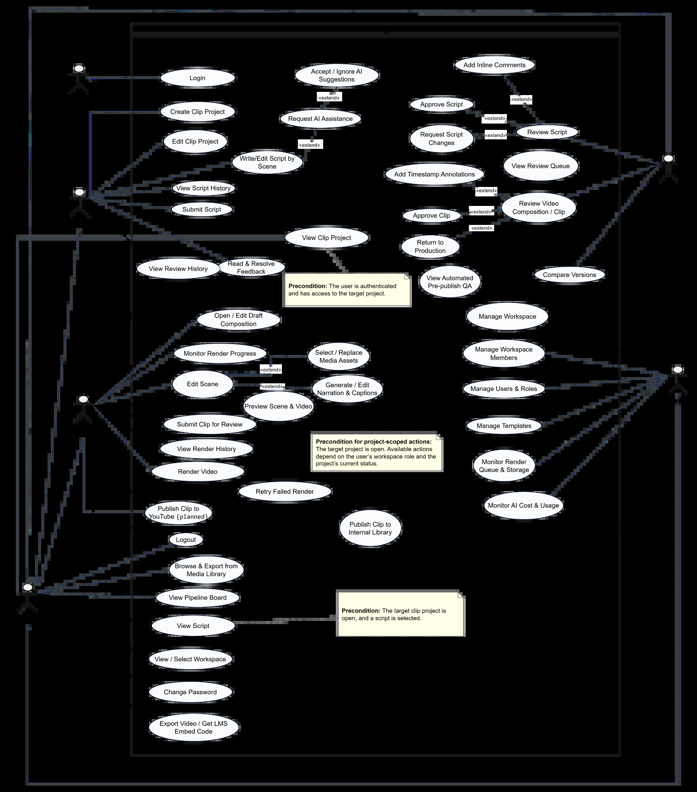

# STEMotion – Report 3: Software Requirement Specification

29/10/2026 · Nguyễn Việt Hoàng

**Project:** STEMotion - AI-Assisted STEM Video Production Platform Using Remotion (FA26SE054) · **Supervisor:** Lại Đức Hùng · **Baseline:** BE `7f207bb`, FE `9129e1f`, RENDER `7e5aeea`. This SRS specifies what the system must do; requirements marked *Planned* come from the mentor meeting of 26/10/2026 and are not yet built.

## I. Record of Changes

| Date | A/M/D | In charge | Change description |
| --- | --- | --- | --- |
| 29/10/2026 | A | Nguyễn Việt Hoàng | First version of Report 3: overall description, actors and use cases, functional requirements per module, screen authorization, non-functional requirements, business rules and messages, aligned with Report 1 (FE-01 to FE-17) and the implemented system. |
| 29/10/2026 | M | Nguyễn Việt Hoàng | Removed Google / OAuth sign-in: accounts are provisioned by an Admin and users sign in with email and password (scope, UC-01, UC-24, FR-02 to FR-05, NFR-08, system context diagram, MSG17, MSG18). |
| 01/11/2026 | M | Nguyễn Việt Hoàng | Replaced Figure 1 with the team's use case diagram; use case list renumbered UC-01 to UC-47 in the order of the diagram, with related FRs; added FR-48 to FR-55 and amended FR-39 (an Admin may publish) and FR-43 (storage used) so that every drawn use case maps to a requirement; section IV.3 headings updated. |

*A - Added, M - Modified, D - Deleted*

## II. Overall Description

### 1. Product Overview

STEMotion is a web platform that carries a short Vietnamese STEM explainer clip from script to published video inside one role-based workflow. A Writer drafts the script scene by scene, a Reviewer approves it with per-scene comments, a Producer tunes the auto-generated Remotion composition and renders it, and the Reviewer approves the clip before it is published to the internal library. AI assists at each step (drafting, segmentation, readability, terminology, narration, captions, quality checks), but every AI result is a suggestion a person accepts or ignores.

### 2. System Context

 (Mermaid source: `docs/diagrams/01-architecture.mmd`)

The web app talks only to the core API; the core API drives the AI service and the render worker, and the worker reports progress back by callback.

| Component | Technology | Responsibility |
| --- | --- | --- |
| Web application | React + Vite, Tailwind CSS, Remotion Player | Role-based studios (Writer, Reviewer, Producer), admin portal, in-browser preview |
| Core API | Spring Boot 3 (Java 17), Spring Security + JWT | Auth, RBAC, workspace and project lifecycle, review, composition, render orchestration, publishing |
| Rendering service | Node.js + Remotion, headless Chromium, job queue | Renders compositions to MP4, TTS narration, duration sync, reports progress by callback |
| AI microservice | Python FastAPI + LangChain; OpenAI / Gemini providers; Whisper | Script drafting and analysis with schema-validated output; word-level caption alignment |
| Database | PostgreSQL (Supabase), Flyway migrations | Users, workspaces, projects, script versions, compositions, render jobs, clips, publications, AI usage |
| Object storage | MinIO / S3-compatible | Rendered MP4 files and media assets |
| External services | FPT.AI / Google Cloud TTS, LLM APIs | Narration voices, language models |

### 3. Scope

In scope are the 17 major features FE-01 to FE-17 of Report 1, extended by the mentor requirements of 26/10/2026 (workspace staffing, Leader permissions, project approval, edit locking, contribution). Limitations LI-01 to LI-10 of Report 1 still apply, with three changes:

- **YouTube publishing (FE-13)** is specified but the API returns *503 PUBLISH\_TARGET\_UNAVAILABLE* until OAuth is configured; publishing to the internal library and an LMS embed code works.
- **LMS embed** exists as a publish target (embed code only); LI-08 still excludes LMS integration beyond that code.
- **Login (FE-01)** uses Admin-provisioned accounts with email and password only. Google / OAuth sign-in from the registered proposal is not used and there is no self-registration.

### 4. User Classes

| User class | Description | Main goals |
| --- | --- | --- |
| Guest | Not signed in | Sign in |
| Writer | Teacher or content author in a workspace | Draft and revise scripts, use AI assistance, answer feedback |
| Reviewer | Subject expert in a workspace | Approve or return scripts and clips with comments |
| Producer | Motion/video producer in a workspace | Build the composition, narration and timing; render; publish |
| Leader | A workspace member flagged as leader (additional responsibility, not a fourth production role) | Assign roles, approve project proposals and join requests, track progress |
| Admin | System administrator | Manage users, workspaces, templates; monitor render queue, storage and AI cost |

### 5. Assumptions and Constraints

- **C-01** Clips are 20 to 180 seconds long (QA bounds); the render-time target covers 60 to 90 seconds.
- **C-02** Output is MP4 H.264 at 30 fps; 720p, 1080p and 1440p presets.
- **C-03** Narration and captions are Vietnamese only.
- **C-04** AI output is advisory; no AI result approves, passes QA or publishes on its own.
- **C-05** Supported browsers: Chrome, Firefox, Edge 100+ and Safari 15+.
- **A-01** Every user belongs to at least one workspace before working on projects; an Admin provisions accounts (no public self-registration).
- **A-02** LLM, TTS and storage providers are reachable and within the configured monthly AI budget.

## III. User Requirements

### 1. Actors

| # | Actor | Description |
| --- | --- | --- |
| 1 | Guest | Anyone not signed in. Can only sign in. |
| 2 | Authorized User | Any signed-in user; generalises Writer, Reviewer, Producer and Admin. Signs out, changes password, views the pipeline board and the media library. |
| 3 | Writer | Creates clip projects and writes scripts scene by scene with AI assistance; answers feedback. |
| 4 | Reviewer | Reviews scripts and clips, adds inline and timestamped notes, approves or returns them. |
| 5 | Producer | Builds the composition from an approved script, tunes narration and timing, renders and publishes. |
| 6 | Leader | A workspace member with the leader flag, not a separate account role. Assigns roles inside the workspace; approves project proposals and join requests (*Planned*). Not drawn in Figure 1 (see the note under the use case list). |
| 7 | Admin | Manages users, workspaces, members, templates; monitors render queue, storage and AI cost. |
| 8 | Render Worker (system) | Renders MP4, synthesises narration, measures durations and reports progress back by callback. Secondary system actor, not drawn in Figure 1. |
| 9 | AI Service (system) | Drafts and analyses scripts, aligns captions to narration. Secondary system actor, not drawn in Figure 1. |

### 2. Use Case Diagram

*Figure 1. Use case diagram of STEMotion (team version, 01/11/2026). Users sign in with email and password on Admin-provisioned accounts; publishing to YouTube is planned. Use case IDs below follow the diagram actor by actor.*

### 3. Use Case List

| ID | Use case | Actor | Feature | Related FR | Status |
| --- | --- | --- | --- | --- | --- |
| UC-01 | Login | Guest | FE-01 | FR-01, FR-02 | Implemented |
| UC-02 | Logout | Authorized User | FE-01 | FR-01 | Implemented |
| UC-03 | Change Password (forced on first login) | Authorized User | FE-01 | FR-04 | Implemented |
| UC-04 | View / Select Workspace | Authorized User | M10 | FR-10, FR-48 | Implemented |
| UC-05 | View Pipeline Board | Authorized User | FE-05 | FR-49 | Implemented |
| UC-06 | View Clip Project | Authorized User | FE-02 | FR-49 | Implemented |
| UC-07 | View Script | Authorized User | FE-03 | FR-15, FR-49 | Implemented |
| UC-08 | Browse & Export from Media Library | Authorized User | FE-14 | FR-41 | Implemented |
| UC-09 | Export Video / Get LMS Embed Code | Authorized User | FE-13, FE-14 | FR-39, FR-41 | Implemented |
| UC-10 | Create Clip Project | Writer | FE-02 | FR-11 | Implemented |
| UC-11 | Edit Clip Project (including archive) | Writer | FE-02 | FR-11, FR-16 | Implemented |
| UC-12 | Write / Edit Script by Scene | Writer | FE-03 | FR-12, FR-13 | Implemented |
| UC-13 | Request AI Assistance («extend» UC-12) | Writer | FE-04 | FR-18 to FR-20, FR-22 | Implemented |
| UC-14 | Accept / Ignore AI Suggestions («extend» UC-13) | Writer | FE-04 | FR-21 | Implemented |
| UC-15 | View Script History | Writer | FE-03 | FR-15 | Implemented |
| UC-16 | Submit Script | Writer | FE-05 | FR-14 | Implemented |
| UC-17 | View Review History | Writer, Producer | FE-06 | FR-51 | Implemented |
| UC-18 | Read & Resolve Feedback | Writer, Producer | FE-06 | FR-25 | Implemented |
| UC-19 | View Review Queue | Reviewer | FE-07 | FR-50 | Implemented |
| UC-20 | Review Script | Reviewer | FE-07 | FR-23, FR-24 | Implemented |
| UC-21 | Add Inline Comments («extend» UC-20) | Reviewer | FE-07 | FR-23 | Implemented |
| UC-22 | Approve Script («extend» UC-20) | Reviewer | FE-07 | FR-24 | Implemented |
| UC-23 | Request Script Changes («extend» UC-20) | Reviewer | FE-07 | FR-24 | Implemented |
| UC-24 | Review Video Composition / Clip | Reviewer | FE-11 | FR-35 | Implemented |
| UC-25 | Add Timestamp Annotations («extend» UC-24) | Reviewer | FE-11 | FR-35 | Implemented |
| UC-26 | Approve Clip («extend» UC-24) | Reviewer | FE-11 | FR-36 | Implemented |
| UC-27 | Return to Production («extend» UC-24) | Reviewer | FE-11 | FR-37 | Implemented |
| UC-28 | View Automated Pre-publish QA | Reviewer | FE-11 | FR-38 | Implemented |
| UC-29 | Compare Versions (script versions, clip renders) | Reviewer | FE-12 | FR-15, FR-55 | Implemented |
| UC-30 | Open / Edit Draft Composition | Producer | FE-08 | FR-26, FR-28 | Implemented |
| UC-31 | Edit Scene | Producer | FE-09 | FR-27 | Implemented |
| UC-32 | Select / Replace Media Assets («extend» UC-31) | Producer | FE-09 | FR-52 | Implemented |
| UC-33 | Generate / Edit Narration & Captions («extend» UC-31) | Producer | FE-09 | FR-29, FR-53 | Implemented |
| UC-34 | Preview Scene & Video | Producer | FE-09 | FR-27 | Implemented |
| UC-35 | Submit Clip for Review | Producer | FE-11 | FR-30 | Implemented |
| UC-36 | Render Video | Producer | FE-10 | FR-32 | Implemented |
| UC-37 | Monitor Render Progress | Producer | FE-10 | FR-33 | Implemented |
| UC-38 | Retry Failed Render | Producer | FE-10 | FR-34 | Implemented |
| UC-39 | View Render History | Producer | FE-10 | FR-54 | Implemented |
| UC-40 | Publish Clip to Internal Library | Producer, Admin | FE-13 | FR-39 | Implemented |
| UC-41 | Publish Clip to YouTube | Producer | FE-13 | FR-40 | Planned |
| UC-42 | Manage Workspace | Admin | M10 | FR-06 | Implemented |
| UC-43 | Manage Workspace Members | Admin | M11, M15 | FR-07 to FR-09 | Implemented |
| UC-44 | Manage Users & Roles | Admin | FE-15 | FR-03, FR-05 | Implemented |
| UC-45 | Manage Templates | Admin | FE-16 | FR-42 | Implemented |
| UC-46 | Monitor Render Queue & Storage | Admin | FE-17 | FR-43 | Implemented |
| UC-47 | Monitor AI Cost & Usage | Admin | FE-17 | FR-43 | Implemented |

Detailed requirements are in section IV.3. «extend» marks optional behaviour started from the base use case; Writer, Reviewer, Producer and Admin inherit every Authorized User use case. Not drawn in Figure 1: the Leader's role assignment (FR-08, implemented: a member with the leader flag changes roles inside UC-43) and the *Planned* functions FR-17, FR-31 and FR-44 to FR-47 (project proposal, edit lease, AI/TTS configuration, join requests, contributions, Leader dashboard), which are outside the registered scope (Design Brief section 1.2).

## IV. Functional Requirements

### 1. System Functional Overview

#### 1.1 Screen Flow

Screen flow: Mermaid source `docs/diagrams/15-screen-flow.mmd`.

Change Password and Workspace Picker appear only when needed; otherwise Login goes straight to the Project Dashboard.

#### 1.2 Screen Descriptions

| # | Screen | Description |
| --- | --- | --- |
| 1 | Login | Email + password sign-in for accounts created by an Admin; no registration link. |
| 2 | Change Password (modal) | Forced after the first login of an Admin-provisioned account. |
| 3 | Workspace Picker (modal) | Choose the active workspace when the user belongs to several. |
| 4 | Project Dashboard | Pipeline board of the workspace's projects with stage badges, filters and the user's next action. |
| 5 | Create Project (modal) | Title, subject, grade; optional AI draft from a topic with three teaching approaches. |
| 6 | Writer Studio | Scene list and scene editor, autosave, AI actions, TTS preview, duration sync, review notes and reject reason, submit for review. |
| 7 | Version Diff (modal) | Side-by-side differences between two script versions. |
| 8 | Reviewer Studio | Script review with per-scene notes; video review in the web player or MP4 with timestamped notes; QA report; approve, request changes, send back. |
| 9 | Clip Compare (modal) | Two renders of the same project side by side. |
| 10 | Producer Studio | Composition editor: scene properties, visual theme, blocks, timing, TTS preview, duration sync, render and progress, submit for video review. |
| 11 | Publish (modal) | Choose targets (internal library, LMS embed, YouTube), title and description. |
| 12 | Media Library | Published clips with subject and grade filters, playback and export links. |
| 13 | Admin Portal | Overview metrics, users, workspaces and members, templates, render queue, AI cost and usage. |
| 14 | Create Workspace (form) | Name, department, leader and at least two more members covering the three roles. |
| 15 | Manage Members (modal) | Member list; Admin adds, removes, activates and appoints leaders; Leader changes roles only. |
| 16 | Template Catalog (modal) | Browse scene templates with recommended subjects and default theme. |

#### 1.3 Screen Authorization

| Screen | Writer | Reviewer | Producer | Leader | Admin |
| --- | --- | --- | --- | --- | --- |
| Project Dashboard | X | X | X | X | X |
| Create Project | X |  |  |  | X |
| Writer Studio (edit) | X |  |  |  | X |
| Writer Studio (read only) |  | X | X | X | X |
| Reviewer Studio (decide) |  | X |  |  | X |
| Producer Studio (edit) |  |  | X |  | X |
| Publish |  |  | X |  | X |
| Media Library | X | X | X | X | X |
| Manage Members: view | X | X | X | X | X |
| Manage Members: change role |  |  |  | X | X |
| Manage Members: add, remove, status, leader |  |  |  |  | X |
| Admin Portal, Create Workspace, Template admin |  |  |  |  | X |

Roles are checked on the server for every request (BR-20); the screen matrix only decides what the user sees. *Planned:* the Admin column loses content decisions (approve, request changes, approve video) unless the Admin is also a project Reviewer.

#### 1.4 Non-Screen Functions

| # | Function | Description |
| --- | --- | --- |
| 1 | Scene autosave queue | Coalesces edits into one save after 600 ms of inactivity and runs saves of one script in order, sending the draft revision. |
| 2 | Render orchestration | Freezes the approved composition revision, queues a render job, retries up to 3 times, records the resulting clip artifact. |
| 3 | Render callback | Worker reports QUEUED, PROCESSING, COMPLETED or FAILED with progress and the video URL, authenticated by a shared service key. |
| 4 | Pre-publish QA engine | Checks duration bounds, pacing, on-screen text, contrast, caption freshness and alignment on the composition as rendered. |
| 5 | AI gateway and usage log | Sends AI requests to the AI service, validates structured output, records model, tokens, cost and the user's accept/ignore decision. |
| 6 | Narration tools | TTS preview through the worker; duration sync with TTS + Whisper word timings. |
| 7 | Request metrics | Logs method, path, status, duration and query count per request. |

### 2. Entity Overview

| Entity (table) | Purpose |
| --- | --- |
| User (`users`) | Account, system role, status, must-change-password flag |
| Workspace (`workspaces`) | Subject department (tổ bộ môn) |
| WorkspaceMember (`workspace_members`) | User in a workspace with one production role, leader flag, ACTIVE/INACTIVE |
| ClipProject (`clip_projects`) | Project with subject, grade, owner, script status, video status, archive flag |
| ScriptVersion (`script_versions`) | Immutable submitted version or the working draft, with draft revision |
| Scene (`scenes`) | Ordered scene of a script version: template type, narration, duration, props |
| Composition (`compositions`) | Producer's revisioned copy of the approved scenes plus visual theme |
| RenderJob (`render_jobs`) | Render of one composition revision: status, progress, attempts, resolution |
| Clip (`clips`) | Completed MP4 artifact of a render job |
| FeedbackComment (`feedback_comments`) | Inline (scene) or timestamped (clip) note, replies, resolved by/at |
| StatusHistory (`status_histories`) | Pipeline transitions and review decisions with actor and reason |
| AiRequest (`ai_requests`) | AI call, model, tokens, cost, outcome, user decision |
| RemotionTemplate (`remotion_templates`) | Template registry metadata, recommended subjects, default theme |
| Publication / PublishRecord (`publications`, `publish_records`) | Where a clip was published and the publish history |

*Planned (V23+):* ProjectProposal, ProjectMember, ProjectJoinRequest, EditLease, ContributionEvent, LegacyMembershipFinding.

### 3. Functional Requirement Details

Each requirement is testable; *Planned* marks requirements from the mentor meeting not yet built.

#### 3.1 Authentication and Accounts (UC-01 to UC-03, UC-44)

- **FR-01** The system shall authenticate users by email (case-insensitive) and password and issue a JWT.
- **FR-02** The system shall not offer public self-registration or third-party (Google / OAuth) sign-in; every account is created by an Admin.
- **FR-03** An Admin shall create an account with full name, email (unique, case-insensitive), initial password and system role, and hand the credentials to the user.
- **FR-04** An Admin-provisioned account shall be forced to change its password at first login.
- **FR-05** An Admin shall change an account's role, activate or deactivate it, or delete it; inactive accounts cannot sign in.

#### 3.2 Workspaces and Members (UC-04, UC-42, UC-43)

- **FR-06** An Admin shall create a workspace with a leader and members totalling at least 3 different active users covering WRITER, REVIEWER and PRODUCER (BR-01); a refused request writes nothing.
- **FR-07** Only an Admin shall add or remove members, change a member's status or appoint/revoke a leader (BR-02).
- **FR-08** A Leader shall change members' roles inside their own workspace.
- **FR-09** The system shall refuse any member change that leaves a covered production role without an active member, and the removal of the last active leader (BR-03).
- **FR-10** Every member of a workspace shall see the member list read-only.
- **FR-48** A user who belongs to several workspaces shall choose the active workspace; lists and actions are scoped to it.

#### 3.3 Projects and Scripts (UC-05 to UC-07, UC-10 to UC-12, UC-15, UC-16)

- **FR-11** A Writer shall create a project with title, subject (Math, Physics, Chemistry, Biology, Computer Science) and grade.
- **FR-12** A Writer shall add, edit, reorder and delete scenes of the working draft; each scene has a template type, title, narration, duration and template props validated per type.
- **FR-13** The system shall autosave the draft and protect it with a draft revision: a save based on an older revision is refused with 409 STALE\_REVISION and changes nothing (BR-10).
- **FR-14** A Writer shall submit a draft with at least one scene; the version becomes immutable and the project moves to IN\_REVIEW.
- **FR-15** Users shall view every stored version and the differences between two versions.
- **FR-16** The owner, a Leader or an Admin shall archive a project; archived projects disappear from lists but keep their clips.
- **FR-17** *Planned.* A Writer shall propose a project; a Leader approves (exactly once) or rejects with a reason; a Writer who is a Leader approves their own proposal (BR-30).
- **FR-49** Users shall view the pipeline board of their workspace's projects with stage, owner and next action, and open a project and its script read-only unless their role allows editing.

#### 3.4 AI Assistance (UC-13, UC-14)

- **FR-18** A Writer shall request a draft script from a topic, subject and grade, optionally following one of three AI-proposed teaching approaches.
- **FR-19** A Writer shall run resegment, readability grade, concept extraction and terminology checks on a script.
- **FR-20** The system shall reject topics that are not STEM-related with an explanatory message.
- **FR-21** Every AI result shall be stored as a suggestion; the Writer accepts or ignores it, and nothing is saved into the script automatically (BR-12).
- **FR-22** The system shall record model, tokens, cost and outcome of every AI request; malformed, refused or timed-out responses produce no result.

#### 3.5 Script Review and Feedback (UC-17 to UC-23)

- **FR-23** A Reviewer shall add comments pinned to a scene of the version in review.
- **FR-24** A Reviewer shall approve the version or request changes with a mandatory reason; requesting changes opens a new draft version for the Writer.
- **FR-25** Writers and Producers shall reply to notes and mark a root note resolved; the system records who resolved it and when.
- **FR-50** A Reviewer shall see a queue of scripts and compositions waiting for review in their workspaces.
- **FR-51** Writers and Producers shall see the review history of a project: script and video decisions with reviewer, reason and time.

#### 3.6 Production (UC-30 to UC-35)

- **FR-26** Opening an approved script shall create revision 1 of its composition from the approved scenes.
- **FR-27** A Producer shall edit scene properties, visual theme and composed blocks and preview them in the Remotion Player.
- **FR-28** Every composition save shall name its base revision; a stale save is refused with 409 STALE\_REVISION.
- **FR-29** Writers (on drafts) and Producers (on compositions) shall preview TTS narration and sync scene durations to measured speech; a sync whose resource changed while measuring is refused and writes nothing (BR-11).
- **FR-30** A Producer shall submit the composition for video review; the reviewed revision is frozen (IN\_QA).
- **FR-31** *Planned.* Only the holder of a valid edit lease shall write the script draft or composition; others see it read-only (BR-31).
- **FR-52** A Producer shall select or replace the media assets of a scene (scene template from the catalog, STEM icons of illustrated scenes) without changing other scenes.
- **FR-53** The system shall generate word-timed Vietnamese captions from the scene narration when rendering; editing the narration updates its captions on the next sync or render.

#### 3.7 Rendering (UC-36 to UC-39)

- **FR-32** A Producer shall start a render of the frozen or approved composition at 720p, 1080p or 1440p; only one render per project runs at a time.
- **FR-33** The system shall show live status and progress and retry a failed job up to 3 times before marking it FAILED.
- **FR-34** A Producer shall retry or cancel a job; a completed render is recorded as a clip of that composition revision.
- **FR-54** A Producer shall see the render history of a project: every job with status, resolution, attempts, time and its clip.

#### 3.8 Clip Review and QA (UC-24 to UC-29)

- **FR-35** A Reviewer shall review the submitted composition in the web player or its MP4 and add timestamped notes scoped to the clip under review.
- **FR-36** A Reviewer shall approve the video only when no open notes block it; approving a composition without an MP4 starts its render (BR-13).
- **FR-37** A Reviewer shall send the video back to production with a mandatory reason.
- **FR-38** The system shall show automated QA findings as decision support; findings never approve or block on their own (BR-12).
- **FR-55** A Reviewer shall compare two renders of the same project side by side.

#### 3.9 Publishing and Library (UC-08, UC-09, UC-40, UC-41)

- **FR-39** A Producer or an Admin shall publish an approved clip to the internal library and/or generate an LMS embed code; each target is published once.
- **FR-40** *Planned.* Publishing to YouTube through the YouTube Data API; until configured the API answers 503 PUBLISH\_TARGET\_UNAVAILABLE.
- **FR-41** Users shall browse published clips with subject and grade filters, play them and copy export links; lists support paging.

#### 3.10 Administration (UC-45 to UC-47)

- **FR-42** An Admin shall create, edit and delete templates, including recommended subjects and default visual theme.
- **FR-43** An Admin shall see render queue state, job success rate, recent jobs, storage used and AI cost and usage against the monthly budget.
- **FR-44** *Planned.* An Admin shall configure allowed AI/TTS providers, models, voices and budgets; secrets are never returned by the API.

#### 3.11 Collaboration and Tracking — *Planned*, not drawn in Figure 1

- **FR-45** Workspace members shall request to join a project with a role; a Leader approves, rejects or revokes; the approved role stays fixed for the project (BR-32).
- **FR-46** The system shall record contribution events (script submission, composition revision, review decision, note resolution, publish) with the actor's role at the time.
- **FR-47** A Leader shall see an inbox of proposals and join requests and a board of projects by stage, owner and blocker.

## V. Non-Functional Requirements

### 1. External Interfaces

| Interface | Requirement |
| --- | --- |
| User interface | Responsive web UI in Vietnamese; every action shows a pending state, blocks double submission and keeps unsaved input on error. |
| REST API | JSON over HTTPS under `/api/v1`, OpenAPI documented; one error envelope `{status, code, message, timestamp, details?}`; list endpoints accept optional `page`/`size` (default 20, max 100) and return `X-Total-Count`, `X-Total-Pages`, `X-Page`, `X-Size`. |
| Render worker | HTTP API secured by a shared service key; progress by callback to the core API. |
| AI service | HTTP API secured by a shared service key; structured JSON validated against schemas. |
| Third parties | LLM providers (OpenAI, Gemini), TTS (FPT.AI, Google Cloud), S3-compatible storage; YouTube Data API *Planned*. |

### 2. Quality Attributes

| ID | Attribute | Requirement | Measure |
| --- | --- | --- | --- |
| NFR-01 | Performance | AI script analysis returns within 15 s. | p95 response time of AI endpoints |
| NFR-02 | Performance | A 60-90 s clip renders in under 5 minutes on the worker pool. | Render job duration |
| NFR-03 | Performance | Dashboards and lists load in under 3 s; reads use a constant number of queries regardless of row count (no N+1). | API latency log, query-count tests |
| NFR-04 | Scalability | Rendering scales horizontally by adding workers; target about 300 render jobs per day and 200 concurrent web users. | Load test |
| NFR-05 | Reliability | Failed render and AI jobs retry up to 3 times before alerting; render output is idempotent per composition revision. | Render retry tests |
| NFR-06 | Reliability | Concurrent edits never overwrite each other silently: draft and composition saves carry a revision and stale writes get 409; membership changes are serialised by a row lock. | Concurrency tests on PostgreSQL |
| NFR-07 | Reliability | Every write is atomic: a failed request leaves no partial data. | Transaction tests |
| NFR-08 | Security | Passwords hashed with BCrypt; sessions by JWT (24 h); accounts only created by an Admin, no self-registration or third-party login. | Code review |
| NFR-09 | Security | Role-based authorization on every endpoint, checked on the server; hidden buttons are never the only control. | Negative authorization tests per endpoint |
| NFR-10 | Security | Secrets (DB, JWT, AI, TTS, service keys) live in environment configuration, never in source, logs or API responses; leaked keys are rotated. | Secret scanning |
| NFR-11 | Security | CORS restricted to the configured front-end origins. | Configuration review |
| NFR-12 | Usability | A first-time Writer can create a project and submit a script without training; error messages say what to fix. | User test with 3 teachers |
| NFR-13 | Compatibility | Chrome, Firefox, Edge 100+ and Safari 15+; output MP4 H.264, 30 fps, 720p/1080p/1440p. | Browser test matrix |
| NFR-14 | Maintainability | Schema changes only through versioned Flyway migrations with rollback scripts and migration tests; production schema is validated at start-up. | Migration test suite |
| NFR-15 | Testability | Automated tests run on every change: 360 back-end tests (5 on a real embedded PostgreSQL) and 188 front-end tests at the baseline. | CI results |
| NFR-16 | Cost control | AI usage is metered per request with model, tokens and cost and compared with a monthly budget. | Admin AI usage dashboard |

NFR-01 to NFR-04 are targets from the registered proposal and have not yet been measured under load; NFR-06 and NFR-15 are verified at the baseline.

## VI. Requirement Appendix

### 1. Project Lifecycle

Project lifecycle: Mermaid sources `docs/diagrams/06-state-script.mmd` (script status) and `docs/diagrams/07-state-video.mmd` (video status); all entity state machines are in Report 4 section 2.2.

The script and the video each pass a Reviewer decision; a returned script or video always carries the reviewer's reason (BR-07). Archiving can happen at any state and hides the project without deleting its clips (BR-16).

### 2. Business Rules

| ID | Rule |
| --- | --- |
| BR-01 | A workspace has at least 3 different active members covering WRITER, REVIEWER and PRODUCER; each member holds exactly one production role (never ADMIN) in that workspace; the leader flag is an extra responsibility. |
| BR-02 | Only an Admin adds or removes workspace members, changes a member's status or appoints a leader; a Leader only assigns roles in their own workspace. |
| BR-03 | No change may leave a production role that has an active member without one, or remove the last active leader. A workspace created before BR-01 may still be changed so that it can be completed. |
| BR-04 | A user belongs to a workspace at most once (unique user per workspace). |
| BR-05 | Only the Writer role creates projects and edits drafts; only DRAFT or CHANGE\_REQUESTED drafts are editable. |
| BR-06 | A submitted script version is immutable; a change request creates a new draft version. |
| BR-07 | Returning a script or a video requires a written reason. |
| BR-08 | A script needs at least one scene before review; clips must be 20 to 180 seconds long to pass QA. |
| BR-09 | Only one render job per project runs at a time; a published clip is not re-rendered. |
| BR-10 | Draft and composition writes name the revision they were based on; a stale revision is refused (409 STALE\_REVISION) and nothing is written. |
| BR-11 | Measured durations are applied only if the draft or composition is still at the revision that was measured. |
| BR-12 | AI suggestions and QA findings are advisory: they never change content, approve, pass or publish without a person. |
| BR-13 | A video is approved only when no open notes of the current clip (or unscoped notes) remain; the approved composition revision is the one rendered and published. |
| BR-14 | Each publish target is used once per project; YouTube publishing is unavailable until OAuth is configured. |
| BR-15 | Only the author of a note, or an Admin, deletes it; replies cannot be resolved separately from their root note. |
| BR-16 | Archiving keeps clips and publications; archived projects are read-only and hidden from lists. |
| BR-20 | Authorization is enforced on the server for every endpoint; the UI never decides permissions. |
| BR-30 | *Planned.* A project starts from an approved proposal; a Writer who is a Leader approves their own proposal; nobody approves their own content or video. |
| BR-31 | *Planned.* Writing a draft or composition requires a valid edit lease (TTL about 90 s, renewed while editing); comments do not. |
| BR-32 | *Planned.* A participant's project role is fixed when approved and does not follow later changes of the workspace role; revoked participants keep their history but cannot write. |

### 3. Common Requirements

- **CR-01** Dates and times are shown to users in Vietnam time (GMT+7).
- **CR-02** Every list that can grow supports server-side paging and returns the paging headers.
- **CR-03** Every state change records who did it and when (status history, resolved by, decided by).
- **CR-04** UI text, narration and captions are Vietnamese; API error messages are in English or Vietnamese and shown to the user as returned.
- **CR-05** A conflict (409) never triggers an automatic retry: the client keeps local edits and offers reload and compare.

### 4. Application Messages

| # | Code | HTTP | Message | When |
| --- | --- | --- | --- | --- |
| MSG01 | BAD\_REQUEST | 400 | Invalid email or password | Login fails |
| MSG02 | PASSWORD\_CHANGE\_REQUIRED | 403 | Password change is required before accessing other resources | First login of a provisioned account |
| MSG03 | ACCESS\_DENIED / FORBIDDEN | 403 | (role-specific message) | Action not allowed for the user's role |
| MSG04 | BAD\_REQUEST | 400 | A workspace needs at least 3 different members (WRITER, REVIEWER and PRODUCER); got N | Workspace created with too few members |
| MSG05 | BAD\_REQUEST | 400 | A workspace needs at least one WRITER, REVIEWER and PRODUCER; missing \[ROLE\] | Workspace created without a role |
| MSG06 | BAD\_REQUEST | 400 | User NAME is not active and cannot join a workspace | Inactive user added |
| MSG07 | BAD\_REQUEST | 400 | This change would leave the workspace without an active \[ROLE\]; give that role to another member first | BR-03 violated |
| MSG08 | FORBIDDEN | 403 | Only a system administrator can change a member's status or leader designation; a workspace leader assigns roles | Leader changes status or leader flag |
| MSG09 | BAD\_REQUEST | 400 | Only a draft or returned script can be edited; submitted versions are immutable | Edit of a submitted version |
| MSG10 | BAD\_REQUEST | 400 | A script needs at least one scene before it can be reviewed | Submit with no scenes |
| MSG11 | STALE\_REVISION | 409 | The draft is now at revision N (your save started from M); reload it before trying again | BR-10, BR-11 (`details` gives resource and revisions) |
| MSG12 | REVIEW\_REASON\_REQUIRED | 400 | Cần ghi lý do khi trả về | Return without a reason (BR-07) |
| MSG13 | BAD\_REQUEST | 400 | Resolve the N open review note(s) before approving the clip | BR-13 |
| MSG14 | CONFLICT | 409 | A render is already running for this project | BR-09 |
| MSG15 | PUBLISH\_TARGET\_UNAVAILABLE | 503 | YouTube OAuth publishing is not configured yet | YouTube target chosen |
| MSG16 | CONFLICT | 409 | A publication for this project and platform already exists | BR-14 |
| MSG17 | FORBIDDEN | 403 | Public registration is disabled. Contact an administrator for an account | Self-registration attempted (FR-02) |
| MSG18 | CONFLICT | 409 | Email is already registered | Admin creates an account with an existing email (FR-03) |

### 5. Open Requirements (pending team decision)

| Decision | Question | Affects |
| --- | --- | --- |
| D03 | Strict black-and-white academic style, or neutral background with one meaningful accent colour? | Visual style of all templates |
| D08, D09 | Is the role fixed per workspace or per project; may a member take a different role in another project of the same workspace? | FR-45, BR-32 |
| D12, D13, D14 | Self-approval and several Leaders; what non-participants may read; when a project must have a Reviewer and a Producer | FR-17, FR-45 |
| D15 | Revoke, rejoin and Admin override | FR-45 |
| D16, D17 | Edit lease scope, TTL, force release; comments while someone edits | FR-31, BR-31 |
| D18 | Contribution for credit and traceability only, or also for evaluation? | FR-46 |
| D04, D07 | AI/TTS providers, budget per clip, who configures them | FR-44, NFR-16 |
| D20 | Final QC on the real MP4 before publishing | FR-36 to FR-39 |
| D-PUB | Who publishes after approval (Producer, Leader) | FR-39 |
| A-acct | Does a member whose account is locked still count toward role coverage? | BR-03 |
| FE-13 | YouTube OAuth channel connection | FR-40 |
