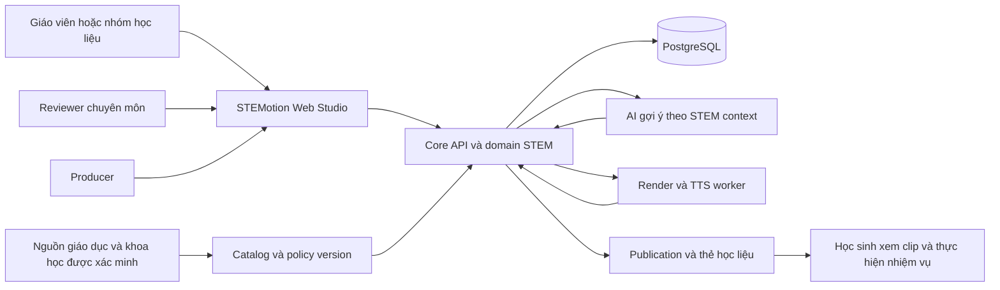
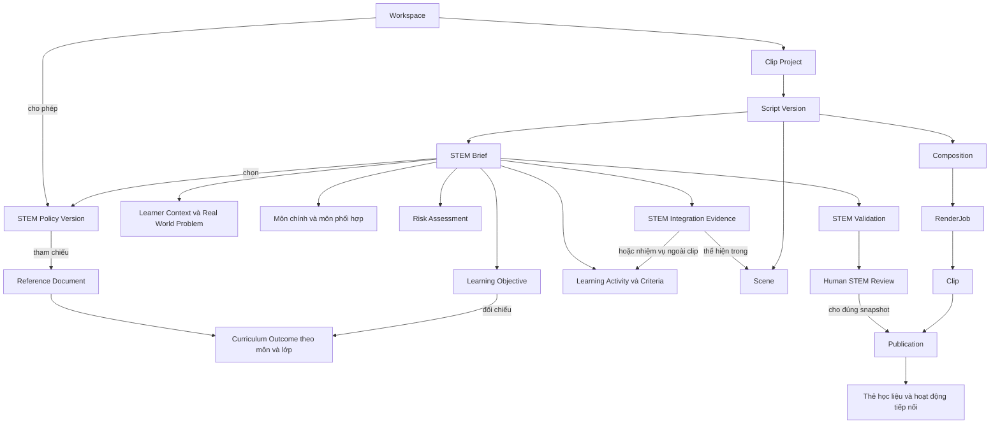
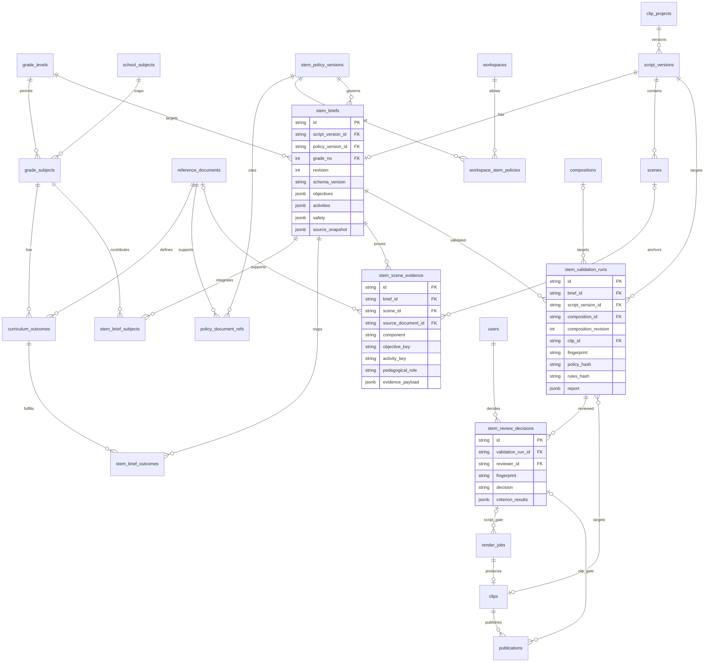
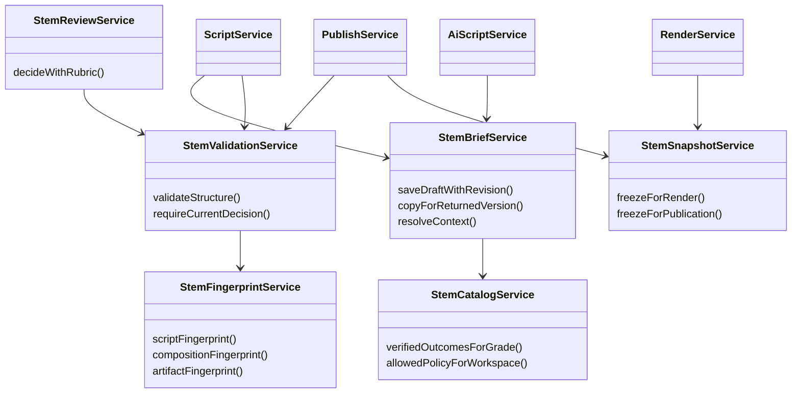
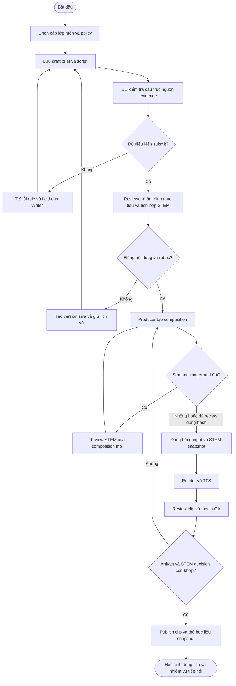
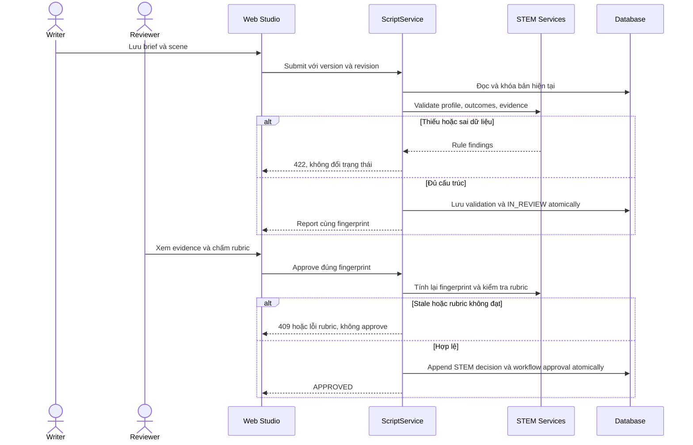
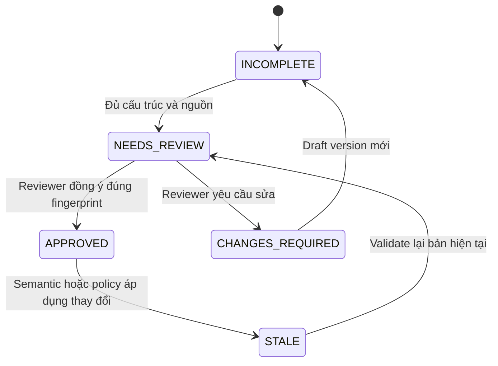

# Sơ đồ và traceability STEM đề xuất

Tất cả sơ đồ trong file này là **TO-BE**, chưa phải bằng chứng chức năng đã triển khai. Giữ sơ đồ gốc để đối chiếu. Mermaid dùng cho context/conceptual/ERD/class/activity/sequence/state; use case UML đúng ký pháp nằm trong [PlantUML riêng](diagrams/stem-usecases.puml). Đây là nguồn sơ đồ có thể chỉnh sửa, chưa xuất ảnh thay vào Word/drawio.

## 1 Context và ranh giới trách nhiệm

Registry do người phụ trách xác minh; mũi tên nguồn không hàm ý hệ thống tự crawl hoặc tự diễn giải pháp luật. Học sinh là đối tượng hưởng lợi, không mặc định user đăng nhập.

## 2 Conceptual domain

Context/Objective/Activity/Safety là value object có schema trong brief ở MVP, không bắt buộc mỗi khái niệm thành một bảng. Subject/Outcome/Policy/Evidence/Decision có dữ liệu và quan hệ độc lập. Conceptual không trộn actor Writer/Reviewer vào entity dữ liệu.

## 3 DB ERD phần mở rộng

Kiểu `string` trong sơ đồ không quy định SQL VARCHAR hay UUID. Xem tài liệu 03 để biết unique/FK/check/invariant và snapshot columns ở render_jobs/clips/publications. Cardinality optional tồn tại để hỗ trợ draft/legacy; **strict submit/publish có điều kiện bắt buộc mạnh hơn ERD**. Không có FK cho `activity_key` nội bộ JSON; service/schema kiểm tra key tồn tại. Không vẽ các FK cũ không liên quan để giữ sơ đồ dễ đọc.

## 4 Class và trách nhiệm

Đây là trách nhiệm logic, có thể gộp class nhỏ trong implementation; không tạo abstraction chỉ để khớp số box. Entity/DTO/repository theo convention package đang có.

## 5 Activity từ brief đến xuất bản

Sơ đồ mô tả invariant, không thay workflow web-first hiện có bằng yêu cầu luôn render MP4 trước mọi review. T09 giữ đường reviewer xem composition trước render; cần quyết định semantic hợp lệ khi render và acceptance đúng artifact khi công bố.

## 6 Sequence submit và approve

## 7 State STEM độc lập pipeline

Đây là view trạng thái suy ra từ report/decision/hash, không sửa đè record quyết định cũ. RenderJob giữ QUEUED/PROCESSING/COMPLETED/FAILED; script/video vẫn giữ enums hiện có.

## 8 Ma trận use case và requirement đề xuất

| Requirement / UC | Actor | Quy tắc | Entity | Gate/API | Acceptance |
|---|---|---|---|---|---|
| FR-ST01 / UC-ST01 Cấu hình phạm vi STEM workspace | Admin | BR-ST01/02 | Policy, WorkspaceStemPolicy | Workspace policy API | AT01/13/14 |
| FR-ST02 / UC-ST02 Chọn chương trình và yêu cầu cần đạt | Writer | BR-ST01/02/03 | GradeSubject, Outcome | Catalog/brief | AT01/04/06 |
| FR-ST03 / UC-ST03 Soạn bối cảnh và hồ sơ STEM | Writer | BR-ST04/05/06 | Brief/Objective/Activity | Brief save/submit | AT03/07/20 |
| FR-ST04 / UC-ST04 Gắn minh chứng STEM với scene/task | Writer | BR-ST07/09/10 | SceneEvidence | Evidence in brief | AT05/06/07 |
| FR-ST05 / UC-ST05 Nhận AI gợi ý theo chương trình | Writer | BR-ST03/10/11 | Brief/AiRequest | Existing AI API extended | AT04/17 |
| FR-ST06 / UC-ST06 Kiểm tra điều kiện nộp script | Writer | BR-ST01…11 | ValidationRun | Submit | AT01–08 |
| FR-ST07 / UC-ST07 Thẩm định nội dung STEM | Reviewer | BR-ST07/08/10/12 | ReviewDecision | Approve extended | AT05/08/09 |
| FR-ST08 / UC-ST08 Bảo toàn nội dung STEM khi dựng | Producer | BR-ST12/13 | Composition/Evidence | Composition update/render | AT10/11/12 |
| FR-ST09 / UC-ST09 Kiểm tra clip theo mục tiêu học | Reviewer | BR-ST08/09/12/13 | Clip/Validation/Decision | Video review | AT10/12/16 |
| FR-ST10 / UC-ST10 Công bố gói học liệu STEM | Producer theo quyền hiện có | BR-ST12/14/15 | Publication/Snapshot | Publish | AT14/15/16 |
| FR-ST11 / UC-ST11 Tìm học liệu theo cấp/lớp/outcome | Authorized User | BR-ST01/03/14 | Publication snapshot | Library | AT15/19 |
| FR-ST12 / UC-ST12 Chuyển đổi project legacy | Writer có quyền + người duyệt | BR-ST15 | Brief/Migration state | Brief update/submit | AT02/18 |

Các use case nền như login, render progress, quản lí thành viên không cần giả tạo hành vi sư phạm riêng. Trong UC specification phải ghi chúng hỗ trợ workspace/project STEM nào, còn nội dung ràng buộc tập trung ở use case tạo/duyệt/sản xuất/công bố. “Mọi use case liên quan STEM” nên hiểu là traceable tới mục tiêu hệ thống, không phải chèn chữ STEM vào mọi nút.
